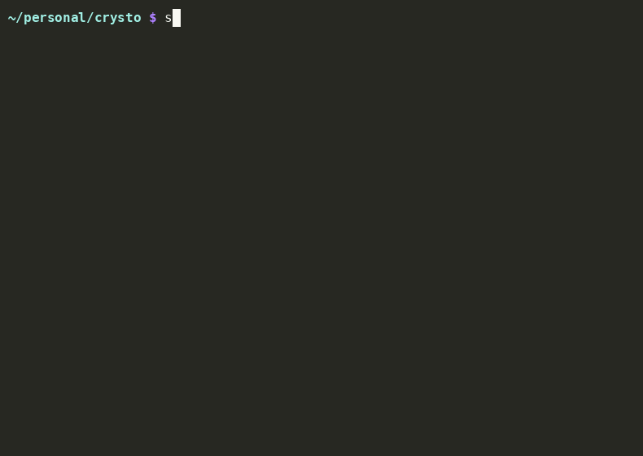
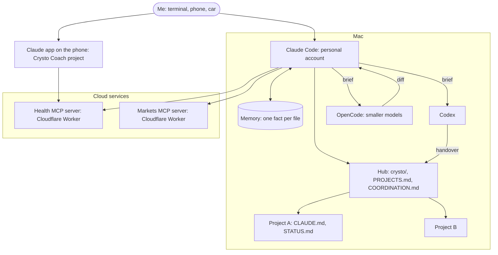
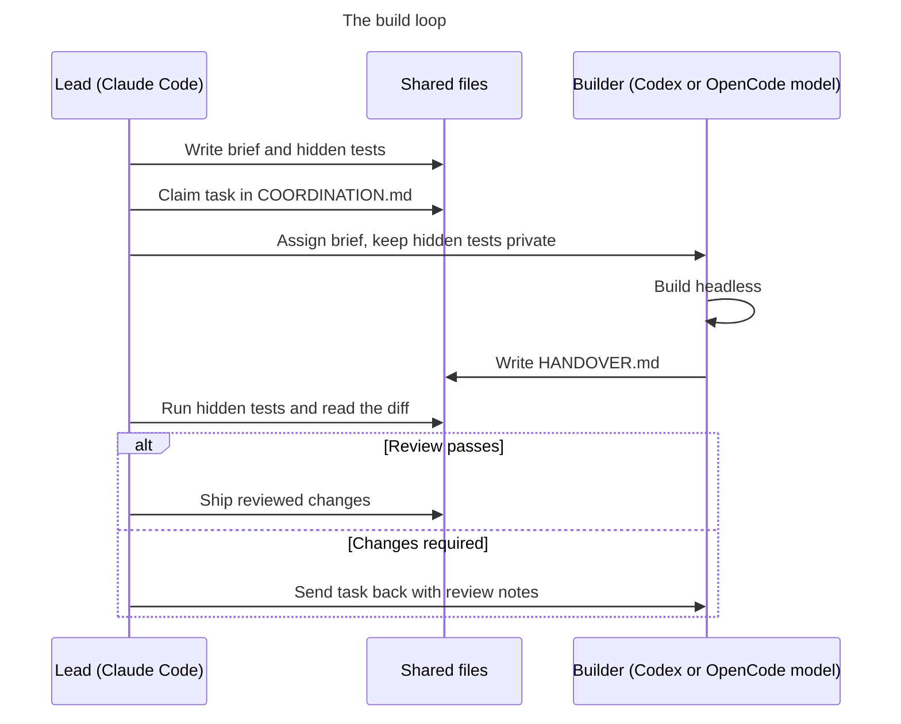
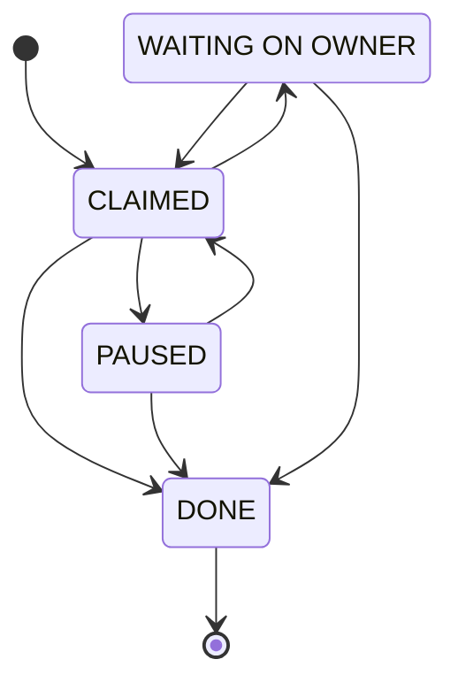

# crysto

File-based coordination for an AI engineering team, with briefs, task claims and reviewed handovers.

[](https://github.com/vanshaj1999/crysto/actions/workflows/check.yml) [](LICENSE)    



A real terminal run of `scripts/new-project.sh` and `make check`.

Crysto is my AI engineering partner and personal assistant. It supports my professional work and
my personal life, each on its own isolated setup. It is not one app. It is a set of rules, files
and connectors that lets several AI agents work together without stepping on each other: Claude
Code, OpenAI Codex, smaller models through OpenCode, and Claude on my phone.

This repo holds the design and the reusable parts: the architecture, the coordination protocol the
agents follow, project templates and a script that creates a new project with all of it in place.
Private memory files, mail, connector data and project notes stay outside this repo.

## What it runs today

| Part | What it does | Status |
| --- | --- | --- |
| Hub | One chat for anything personal. Lists every project and sends real work to that project's own workspace. | Live |
| Projects | One folder per project (websites, fitness, markets and research), each with its own `CLAUDE.md`, `STATUS.md` and memory. | Live, multiple projects |
| Work and personal sides | Separate accounts, credentials and memory for professional and personal work, picked automatically by directory. | Live |
| Agent team | Claude leads and reviews. Codex and smaller OpenCode models do the heavy lifting from written briefs. | Live |
| Health coach | An MCP server over the Google Health API, used by a Claude Project on my phone. | Live, [fitbit-googlehealth-mcp](https://github.com/vanshaj1999/fitbit-googlehealth-mcp) |
| Markets agent | Paper-trading agent on Cloudflare Workers with MCP tools for Claude. | Live, [crysto-markets](https://github.com/vanshaj1999/crysto-markets) |
| Retrieval lab | Measured RAG experiments that feed back into how I build retrieval. | [rag-eval-lab](https://github.com/vanshaj1999/rag-eval-lab) |
| "Hey Crysto" voice | Phone and car assistant over calendar, mail and sleep. | Designed, [docs](docs/voice-assistant-design.md) |



## The ideas that make it work

1. **Files are the shared state, not chats.** Agents do not share a conversation. They share a
   folder: `STATUS.md` says where a project is, `COORDINATION.md` says who owns what, and memory
   holds one fact per file. Any agent can pick up from them cold.
2. **Claim before you touch.** An agent writes a claim (owner, task, next step) before it edits
   files or drives a browser, and does not act on a task another agent owns. See
   [the coordination protocol](docs/coordination-protocol.md).
3. **One browser driver at a time.** Two agents on one Chrome debugging port crash each other. The
   claim covers the browser too.
4. **The lead reviews, the smaller models build.** Claude writes the brief and the hidden tests,
   Codex or a smaller model does the work, and Claude reads every diff before anything ships. A green
   test run is not a review: in my own trials, models passed tests while deleting a test or
   reformatting files outside the task.
5. **Accounts are picked by directory.** A `chpwd` hook sets `CLAUDE_CONFIG_DIR` and `GH_CONFIG_DIR`
   from the current path and prints a line on every change, so personal work never runs on the work
   account by accident. See [shell/account-switch.zsh](shell/account-switch.zsh).
6. **Private by default.** Every project gets a gitignored `private/` folder. No ID numbers,
   passwords or bank details in any file. Public repos are fresh copies that pass a secret scan.
7. **Write for the next agent.** Every agent writes in a controlled, plain English (based on
   ASD-STE100), so handovers read the same whichever model wrote them.



A task claim records the owner and its current state:



More detail: [docs/architecture.md](docs/architecture.md).

## Use it

```bash
git clone https://github.com/vanshaj1999/crysto ~/personal/crysto
cd ~/personal/crysto
make test

# create a project under $CRYSTO_ROOT (default: the folder above this repo)
scripts/new-project.sh research
```

`new-project.sh` creates the folder, git, `CLAUDE.md`, `STATUS.md`, a gitignored `private/`, a
seeded Claude memory folder and a row in `PROJECTS.md`. The templates it uses are in
[templates/](templates/). To pick accounts by directory, source
[shell/account-switch.zsh](shell/account-switch.zsh) from `~/.zshrc` and edit the paths at the
top.

## Repo layout

```text
.
├── .github/workflows/check.yml
├── .gitignore
├── LICENSE
├── Makefile
├── README.md
├── docs/
│   ├── architecture.md
│   ├── coordination-protocol.md
│   ├── media/demo.gif
│   └── voice-assistant-design.md
├── scripts/new-project.sh
├── shell/account-switch.zsh
├── templates/
│   ├── AGENT-BRIEF.md
│   ├── CLAUDE.md
│   ├── COORDINATION.md
│   ├── HANDOVER.md
│   ├── PROJECTS.md
│   ├── STATUS.md
│   └── memory-seed/feedback-read-status-first.md
└── tests/test_new_project.sh
```

The tree includes local task files and the run log. These are not reusable project templates.

## What is not here

- Private memory, project notes, mail, calendar and connector data.
- The briefs and logs of individual agent runs.
- Anything from my professional work. Crysto supports it on a separate, isolated setup, and no
  client code, private data or organisation names are in this repo.

MIT licensed.
