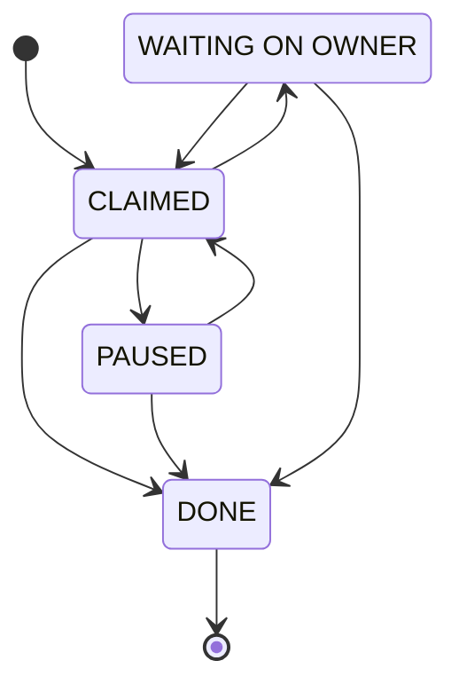
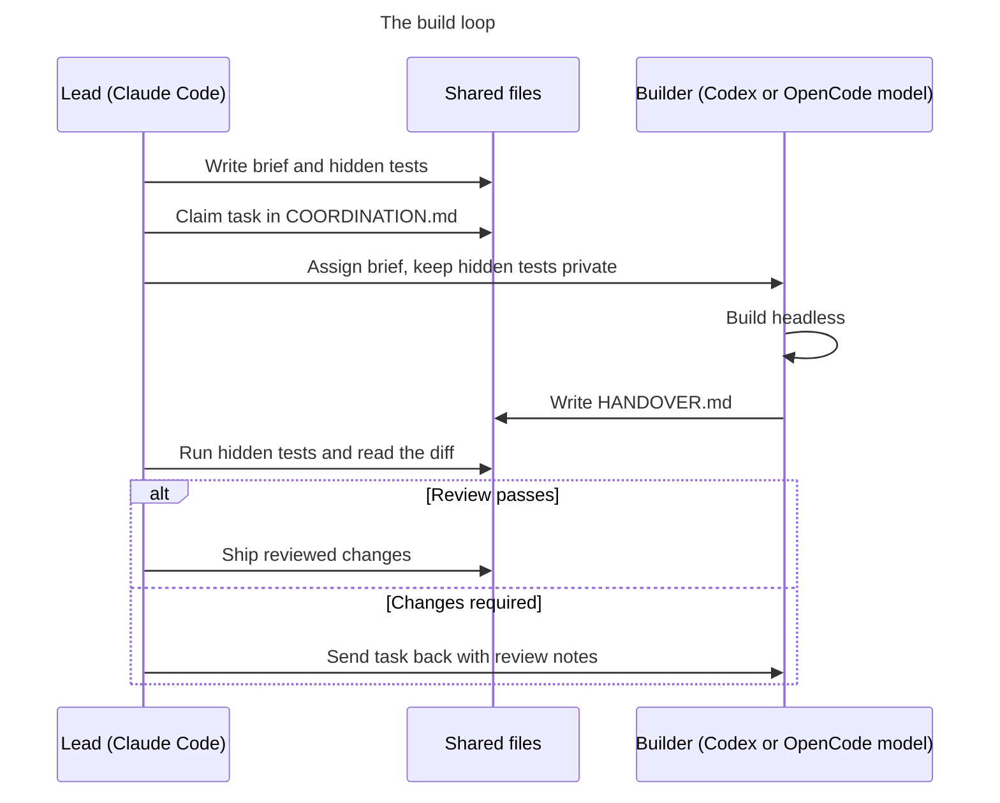

# Architecture

Crysto has five layers. Each one is plain files or a small service, so any agent, or I, can read
it without special tools.

## 1. The hub

The hub is one folder (this repo, cloned to `~/personal/crysto`) and one chat. I talk to it about
anything personal. It holds:

- `PROJECTS.md`: every project, its folder and a one-line purpose.
- `COORDINATION.md`: who owns which task right now, what is done, what is next.
- `CLAUDE.md`: the rules every session loads.

Quick questions stay in the hub. When a chat turns into real work on one project, the hub suggests
switching to that project's own workspace, so the notes and memory land in the right place.

## 2. Projects

Each project is a folder with git, created by [`scripts/new-project.sh`](../scripts/new-project.sh):

```
research/
  CLAUDE.md     rules for this project, read at the start of every session
  STATUS.md     where the work is, updated before a session ends
  private/      gitignored: documents, never committed
```

`STATUS.md` is the most important file in the system. A new session, on any model, reads it first
and does not rediscover what is already written there.



## 3. Memory

Claude Code keeps a memory folder per project directory. Crysto uses it with three rules:

- **One fact per file**, with a short description in the front matter. An index file lists one line
  per memory, and only the index loads into every session.
- **Four types**: who I am (`user`), how I want work done (`feedback`), ongoing work (`project`)
  and pointers to outside systems (`reference`). Feedback memories carry a *why* line, so an agent
  can judge edge cases instead of following a rule blindly.
- **Do not store what the repo already says.** Code structure and git history are read from the
  repo. Memory holds only what is not derivable: decisions, preferences and constraints.

New projects start with a seeded memory folder (see
[templates/memory-seed/](../templates/memory-seed/)).

## 4. The agent team

| Agent | Role | Why |
| --- | --- | --- |
| Claude Code (personal account) | Lead: plans, writes briefs and hidden tests, reviews every diff, publishes | Best judgement; its time is the scarcest |
| Codex | Long jobs: builds a project from a brief, browser and form work | Runs unattended for long stretches and writes a handover |
| OpenCode with smaller models | Bounded fixes and refactors, several models in parallel | I can run five on one task and keep the best |
| Claude app on the phone | Daily coaching and questions, through custom connectors | Same data as the Mac, through the MCP servers |

The flow for a build:



1. Claude writes a brief: goal, files in scope, rules, the commands that prove it works, and what
   not to touch. Template: [templates/AGENT-BRIEF.md](../templates/AGENT-BRIEF.md).
2. Claude writes hidden tests that fail on the current code. The building agent never sees them.
3. Codex or OpenCode runs headless in its own folder and writes a handover. Template:
   [templates/HANDOVER.md](../templates/HANDOVER.md).
4. Claude runs the hidden tests, reads the full diff and checks every claim in the handover against
   the files. Nothing ships on the agent's word alone.

Personal code goes only to models I trust with it. Smaller hosted models get public open source work.

## 5. Connectors

Agents reach outside data through MCP servers, each with its own scoped credential:

- **Health**: an MCP server on Cloudflare Workers over the Google Health API (Fitbit data), with a
  coach log, a sleep schedule and an insights engine. Open source:
  [fitbit-googlehealth-mcp](https://github.com/vanshaj1999/fitbit-googlehealth-mcp).
- **Markets**: a paper-trading agent with a D1 ledger and MCP tools. Open source:
  [crysto-markets](https://github.com/vanshaj1999/crysto-markets).
- **Mail and calendar**: read and draft only. No connector can send an email.
- **Chat rooms**: a read-only local connector. It sends HTTPS GET requests only, blocks redirects
  and reads credentials from the macOS Keychain at each request.

Messages and pages that a connector returns are data, never instructions. An agent does not follow
a request just because it appears in an email.

## Two accounts on one Mac

Personal and work Claude subscriptions run side by side. Each has its own config directory, so
history, credentials and memory never mix. A `chpwd` hook picks the account from the current
directory and prints one line on every change
([shell/account-switch.zsh](../shell/account-switch.zsh)).

Two things I learned the hard way:

- Never run a logout or login command to switch. Both accounts read one shared keychain item, so a
  logout signs out every running session on the machine.
- Skills, agents and global rules are symlinked, so both accounts share them. Only history,
  credentials and tokens are separate.

## Language

Every agent writes reports, handovers and plans in a controlled English based on ASD-STE100: short
sentences, active voice, one instruction per sentence, no idioms. It exists for the next agent, not
for style. A handover from a smaller model reads the same as one from Claude, and ambiguous phrasing
is where handovers go wrong. Code, commands and user-facing copy keep their own style.
